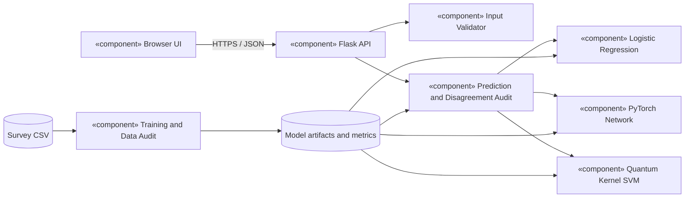
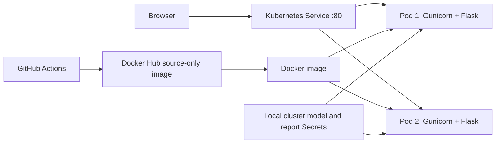

# TriadLens: Software Architecture and Design Specification (IEEE-style)

Version 1.1 | 12 October 2026
Author: project team; student identifiers are kept in the private submission PDFs

## 1. Introduction

This document designs the educational ML/DL/QML disagreement-audit portal defined in SRS v2.1. The design separates offline model training from online inference, retains one reproducible data split, and gives users enough evidence to recognize disagreement and class imbalance. The system is not a clinical decision system.

## 2. Architecture

### 2.1 Pattern and rationale

TriadLens uses a layered modular monolith for online serving plus an offline training pipeline. The browser talks to a Flask HTTP API. The API validates requests, applies saved preprocessing, calls one or more loaded model adapters, and returns JSON. The training pipeline runs separately and persists versioned model artifacts and evaluation reports. This avoids training during requests and keeps the classroom deployment small. Two Kubernetes replicas serve the same immutable artifacts; they do not share patient data or a database.

### 2.2 UML component diagram



The browser has no access to model files. The validator owns field/type constraints. The prediction component selects ML, DL, QML or ALL, and computes an agreement audit only for ALL. The quantum circuit is simulated exactly with NumPy on a CPU; the SVM is classical.

### 2.3 Deployment view



The Dockerfile uses a non-root user, Gunicorn, and port 5000. The Docker context excludes the survey CSV, model artifacts and detailed reports. GitHub Actions builds that source-only image on pushes and pull requests; a successful main-branch run publishes it to the supplied Docker Hub repository. The Kubernetes Deployment requests CPU/memory, sets limits, drops Linux capabilities, uses a read-only root filesystem and mounts a small writable `/tmp` plus read-only model/report Secrets. Startup/readiness probes call `/health/ready`; liveness calls `/health/live`. Publication and live deployment require actual Actions and cluster evidence.

### 2.4 Requirement traceability

| SRS IDs | Design elements | Verification |
|---|---|---|
| FR01–FR02 | Browser form and `/api/example` | ST01, ST16 |
| FR03–FR04, FR11 | Validator, Flask errors and content-length limit | ST05–ST09 |
| FR05–FR07 | Prediction component and three model adapters | ST03–ST04 |
| FR08, FR14 | Saved metrics and `/api/metrics` | ST10, ST13 |
| FR09–FR10 | Training split and training-only transforms | ST10 |
| FR12–FR13 | Health endpoints, Docker, Kubernetes | ST02, ST08, ST18–ST21 |
| FR15 | Disagreement audit and browser panel | ST24–ST25 |
| NFR01–NFR08, SR-01–SR-04 | Tests, security headers, data minimization, non-root deployment | ST04–ST21 |
| FR16, NFR09–NFR10 | GitHub Actions workflow, Docker Hub job, artifact exclusion and Secret mounts | CI run and pending ST26 |

### 2.5 Security architecture

The API accepts a JSON object with exactly `model` and `features`, rejects unknown fields, enforces types and ranges, and limits payloads to 16 KiB. Serialized model files come from trusted local mounts or Kubernetes Secrets, not the public image. Survey inputs are not persisted. Responses use no-store caching, nosniff, and a same-origin Content Security Policy. The image runs as UID 10001 and the manifest drops capabilities. The service must be exposed through HTTPS for any networked demonstration; the local port-forward is intended for a lab environment.

## 3. Detailed design

### 3.1 Data and model pipeline

The input CSV has 309 rows and 16 columns. The pipeline strips column whitespace, removes 33 exact duplicates, and excludes two contradictory-label rows. The remaining 274 rows are stratified with seed 42 into 175 training, 44 validation and 55 held-out test rows. StandardScaler, PCA and angle scaling are fitted on training records only. Logistic regression uses balanced class weights. The PyTorch network has 15 inputs, two ReLU hidden layers (32 and 16 units) and one output logit; validation loss selects its checkpoint. QML maps four PCA components to a four-qubit RY/RZ/CNOT statevector, computes a fidelity kernel, and fits a classical SVM. The test partition is used only for final evaluation.

### 3.2 UML sequence diagram: all-model comparison

```mermaid
sequenceDiagram
  actor Student
  participant UI as Browser UI
  participant API as Flask API
  participant V as Validator
  participant M as Loaded model adapters
  Student->>UI: Enter 15 features and choose ALL
  UI->>API: POST /api/predict JSON
  API->>V: Validate exact schema and feature codes
  alt Invalid
    V-->>API: Validation error
    API-->>UI: 400 JSON error
  else Valid
    V-->>API: Normalized features
    API->>M: Predict ML, DL, QML
    M-->>API: Three labels and scores
    API->>API: Count agreement; flag disagreement/extrapolation
    API-->>UI: Results, comparison, warnings
  end
  UI-->>Student: Show model cards and audit panel
```

### 3.3 UML sequence diagram: train and publish artifacts

```mermaid
sequenceDiagram
  actor Operator
  participant T as train.py
  participant D as CSV and split logic
  participant M as Three model trainers
  participant R as Artifacts/reports
  Operator->>T: python train.py
  T->>D: Audit, clean, stratify seed 42
  D-->>T: Train, validation, test IDs
  T->>M: Fit preprocessing and ML/DL/QML on train
  M-->>T: Trained models; DL validation checkpoint
  T->>M: Evaluate once on held-out test
  M-->>T: Predictions and scores
  T->>R: Save models, split IDs, metrics, predictions
  R-->>Operator: Reproducible evidence files
```

### 3.4 API contracts

| Method/path | Input | Output or error |
|---|---|---|
| GET `/` | None | Browser interface |
| GET `/api/example` | None | One training-partition example; 503 if missing |
| GET `/api/metrics` | None | Saved split and model metrics; 503 if missing |
| POST `/api/predict` | `{model: ML|DL|QML|ALL, features: 15 fields}` | `results`, `comparison`, `warnings`, `note` |
| GET `/health/live` | None | 200 if process responds |
| GET `/health/ready` | None | 200 if all artifacts load, otherwise 503 |

Each result includes `model`, YES/NO dataset `label`, numeric `score`, `score_type`, illustrative `risk` metadata and `inference_ms`. The QML score is an SVM margin, not a probability. The `comparison` object is null for individual model selection; for ALL it includes per-model labels, agreement_count, unanimous, majority_dataset_label, review_flag and review_reasons. The majority label is descriptive and is not used to change any model output.

### 3.5 Error handling and boundaries

400 indicates invalid JSON structure or feature value; 405 unsupported method; 413 oversized body; 415 wrong content type; 503 missing model/metric artifacts. Unexpected errors are logged server-side and returned as a generic 500 response without a stack trace. An age outside the training range is accepted when within the API range but produces a warning and review flag. There is no persistence of individual survey submissions.

### 3.6 Design limits

Only 55 cleaned records form the test set, including seven NO labels, so the reported metrics are unstable and are not clinical validation. QML uses four PCA dimensions whereas ML and DL use 15 inputs. The simulator does not run on quantum hardware or demonstrate a speed advantage. The local CSV provenance and binary-code meanings are not verified. No authentication is provided because the prototype does not store user accounts or prediction histories.

## 4. Change control and verification

Changes to preprocessing require retraining all three models, updating split/metric reports, and rerunning tests. Changes to the disagreement rule require updates to FR15, ST24–ST25, the API contract and the browser panel. Git tracks reviewed source changes; GitHub hosts the pull request. GitHub Actions runs checks and builds the source-only image for pushes and pull requests, then publishes to Docker Hub from main when checks pass. The Kubernetes image reference must be set to its published SHA tag.
