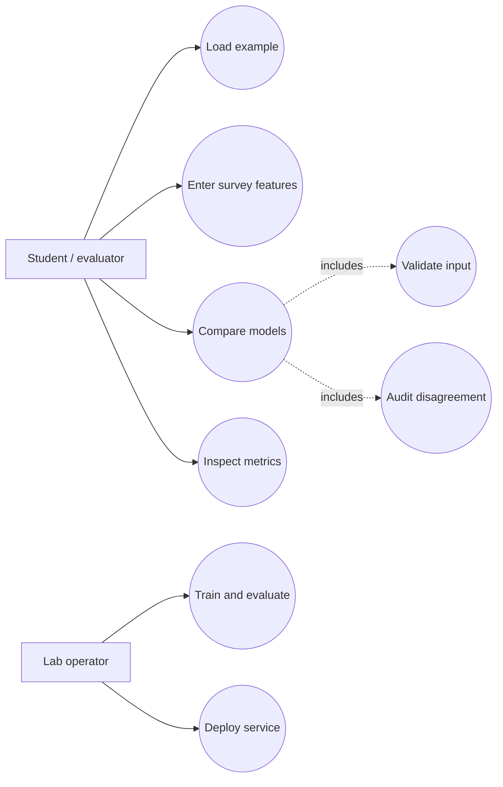

# TriadLens: ML, DL and QML Disagreement Audit
# Software Requirements Specification (IEEE-style)

Version 2.0 · 9 October 2026 · Prepared for the software engineering mini-project

Student: project team  
Class, section and instructor: complete on the private submission copy

## 1 Purpose and scope

**Problem statement.** Small, imbalanced health-survey datasets can produce deceptively similar accuracy scores from very different models. A single predicted label hides disagreement, class imbalance, and extrapolation beyond the training data. TriadLens is a full-stack educational audit portal that trains classical ML, deep learning and simulated quantum ML on one reproducible survey split, then shows model disagreement, a descriptive majority dataset label, the majority-class baseline and an age-range warning for each comparison. It is intended to help students inspect model behavior, not to diagnose disease.

The application classifies records from the supplied lungcancer.csv dataset using machine learning, deep learning and simulated quantum machine learning. A student enters the 15 survey features, selects a model or all three, and reviews predicted YES/NO dataset labels, an agreement audit and held-out evaluation metrics. The project includes training code, saved artifacts, a Python backend, a browser interface, CI, Docker and Kubernetes deployment configuration.

This document describes the implemented local application and the intended container deployment. Local model/API checks have passed. Live Docker and Kubernetes acceptance is pending because the execution environment denied Docker access and has no current Kubernetes context. The system is a classroom demonstration, not a clinical decision support system.

## 2 Stakeholders and operating environment

The student operates and explains the application. The instructor reviews the implementation, methodology, documentation and demonstration. A lab operator starts the application or deploys it to a local Kubernetes cluster. User accounts, administrative screens, clinical users, medical records and persistent prediction histories are outside scope.

The verified development environment is Windows with Python 3.13, NumPy 2.3.3, pandas 2.3.2, scikit-learn 1.9.0, PyTorch 2.13.0 CPU, Flask 3.1.3 and SciPy 1.18.1. The Dockerfile targets Linux with Python 3.13 and Gunicorn. A browser, a working Docker engine and a Kubernetes cluster are required for the full deployment demonstration. Internet access is required for initial dependency and image installation; prediction itself does not call an external API.

## 3 Data requirements

Only the teacher-provided lungcancer.csv is used. It contains 309 rows, 15 inputs and one target column. The original CSV remains unchanged. Training strips leading/trailing column-name whitespace and rejects missing values or invalid categories. It removes 33 exact duplicates and excludes both members of one contradictory-label pair, leaving 274 usable records. Exclusion is deterministic and recorded in reports/metrics.json.

| Field | Accepted values | Interpretation |
|---|---|---|
| GENDER | F or M | Preserve dataset category; encode F=0 and M=1 |
| AGE | Integer 0 to 120 | API input range; warn outside the learned training age range |
| SMOKING, YELLOW_FINGERS, ANXIETY, PEER_PRESSURE | Numeric 1 or 2 | Preserve source codes; encode 1→0 and 2→1 internally |
| CHRONIC DISEASE, FATIGUE, ALLERGY, WHEEZING | Numeric 1 or 2 | Same coding rule |
| ALCOHOL CONSUMING, COUGHING, SHORTNESS OF BREATH | Numeric 1 or 2 | Same coding rule |
| SWALLOWING DIFFICULTY, CHEST PAIN | Numeric 1 or 2 | Same coding rule |
| LUNG_CANCER | NO or YES | Training target only; NO=0 and YES=1 |

The local CSV does not establish its original source, license or binary-feature codebook. A public [Survey Lung Cancer dataset copy](https://huggingface.co/datasets/nateraw/lung-cancer) has 309 rows and matching columns, but byte identity with the local file has not been verified. The interface displays Code 1 and Code 2 rather than inventing meanings. The target is never accepted as a prediction input. Dataset row numbers in split reports refer to the cleaned, reset-index dataset.

### 3.1 UML use case diagram



UC-01 load example; UC-02 enter features; UC-03 compare models, including validation and disagreement audit; UC-04 inspect metrics; UC-05 train/evaluate; UC-06 deploy. The included audit applies when all three models are selected.

## 4 Functional requirements

| ID | Requirement | Acceptance evidence |
|---|---|---|
| FR01 | The application shall serve a form containing all 15 input fields. | ST01 and manual ST16 |
| FR02 | The application shall load a sample from the training partition on request. | Manual ST16 and /api/example |
| FR03 | The API shall accept exactly model and features, rejecting missing or extra keys. | ST06 |
| FR04 | The API shall validate field types, finite integer ages and categorical codes. | ST05 and ST09 |
| FR05 | The application shall run ML, DL, QML or all three on the supplied record. | ST03 and ST04 |
| FR06 | The application shall display predicted label, score type and inference time for each selected model. | ST03, ST04 and manual ST16 |
| FR07 | The application shall distinguish the QML decision margin from a probability. | ST03 response inspection and ST16 |
| FR08 | The application shall expose saved accuracy, balanced accuracy, precision, recall, F1, ROC AUC and split details. | ST13 |
| FR09 | Training shall use disjoint, reproducible train, validation and test partitions. | ST10 |
| FR10 | Learned preprocessing shall be fitted only on training data and reused at prediction time. | ST04 and ST10 |
| FR11 | The application shall return appropriate JSON errors for invalid transport and unavailable models. | ST07 and ST08 |
| FR12 | The service shall expose separate liveness and readiness endpoints. | ST02 and ST08 |
| FR13 | The container deployment shall run two replicas reachable through a Kubernetes Service. | Pending ST18 and ST19 |
| FR14 | Training shall persist the models, split IDs, version information and held-out predictions. | ST04, ST10 and ST13 |
| FR15 | For ALL, the API shall report labels, agreement count, unanimity, a descriptive majority dataset label and review reasons for disagreement or age extrapolation; for one model, comparison shall be null. | ST24 and ST25 |

## 5 Nonfunctional requirements

| ID | Requirement and measurable criterion | Verification |
|---|---|---|
| NFR01 | Local API outputs shall match offline held-out predictions for all three models. | ST04 checks all 55 test records |
| NFR02 | Invalid requests shall not expose stack traces; requests above 16 KiB shall be rejected. | ST05–ST08 |
| NFR03 | Survey submissions shall not be written to application storage. Response caching shall be disabled. | Source inspection and ST14 |
| NFR04 | The interface shall remain usable at 375 px width, with keyboard input and visible focus. | Manual ST17 pending |
| NFR05 | Repeated identical inputs shall produce the same label and score within the running process. | ST15 |
| NFR06 | A missing model artifact shall make readiness fail while liveness remains available. | ST08 |
| NFR07 | Container configuration shall run as a non-root user with bounded resources. | Manifest inspection; live ST18 pending |
| NFR08 | All local automated acceptance checks shall pass before submission. | 57 tests pass locally; JUnit evidence in the private submission bundle |
| NFR09 | GitHub Actions shall run Python and JavaScript checks on pushes and pull requests, then build the Docker image if tests pass. | Workflow inspection; remote CI run pending |

There is no medically meaningful accuracy acceptance threshold. The project reports measured results transparently and includes the majority-class baseline. No sustained load, multi-user capacity or production availability guarantee has been established.

### 5.1 Security objectives and requirements

**SO-01 Integrity:** malformed survey values must not reach saved models or change artifacts. **SO-02 Privacy:** submissions must not be retained or cached. **SO-03 Isolation:** the container must use a non-root identity and bounded resources.

**SR-01:** `/api/predict` shall accept only the exact JSON schema and validated feature codes (ST05–ST07). **SR-02:** bodies above 16 KiB shall be rejected (ST07). **SR-03:** responses shall carry `Cache-Control: no-store`, `X-Content-Type-Options: nosniff` and a same-origin Content Security Policy (ST14). **SR-04:** the container shall run non-root without added Linux capabilities (manifest inspection and pending ST18–ST19).

## 6 Architecture and interfaces

```text
Offline training
lungcancer.csv → validation and cleaning → stratified split
  → training-only StandardScaler
  ├─ logistic regression → ml.joblib
  ├─ neural network with validation early stopping → dl.pt
  └─ training-only PCA and angle scaling → simulated quantum kernel → qml.joblib
  → evaluation reports and split evidence

Online prediction
Browser form → POST /api/predict → Flask validation → saved preprocessing
  → selected saved model(s) → JSON results → browser result cards

Deployment
Browser → local port-forward → Kubernetes Service → one of two application Pods
```

The frontend is HTML, CSS and JavaScript served by Flask. The backend validates JSON and loads trusted local model files once at startup. No database is necessary because the requirements do not include accounts or stored predictions. Training is a separate command and does not run inside prediction requests.

| Endpoint | Contract |
|---|---|
| GET / | Return the prediction interface |
| POST /api/predict | JSON object with model in ML, DL, QML, ALL and the exact feature object |
| GET /api/metrics | Return the saved evaluation report; 503 if absent |
| GET /api/example | Return one complete training example; 503 if absent |
| GET /health/live | Return 200 when the service process responds |
| GET /health/ready | Return 200 when models load; otherwise 503 |

Prediction responses contain results, warnings and an educational-use note. Each result contains model, label, score, score_type and inference_ms. Error status codes include 400 for invalid data or malformed JSON, 405 for unsupported methods, 413 for oversized payloads, 415 for unsupported content type and 503 for unavailable models.

For ALL, `comparison` contains each label, agreement_count, unanimous, majority_dataset_label, review_flag and review_reasons. For an individual model, comparison is null. A majority dataset label is descriptive, not a clinical vote.

## 7 Model design and evaluation

The cleaned dataset is split with random seed 42 into 175 training, 44 validation and 55 test records. The same rows are used across the three implementations. Training class frequencies determine balanced weights. Test data is held out from preprocessing, training and checkpoint selection.

ML uses logistic regression with balanced class weights and a maximum of 2000 solver iterations. DL uses 15 inputs, hidden layers of 32 and 16 ReLU units and one output logit. Adam minimizes weighted binary cross-entropy with logits. Early stopping selects the best validation-loss checkpoint, with a maximum of 500 epochs and patience of 40. A sigmoid is applied only when producing the DL score.

QML uses four training-fitted PCA components, scaled into angles from minus pi to pi. The simulator starts at state 0000 and applies two rounds of RY and RZ rotations followed by CNOT gates 0→1, 1→2 and 2→3. The squared magnitude of the inner product between two feature states is their quantum fidelity kernel. A classical SVM with C=1 and balanced class weights learns on the precomputed kernel. The kernel is evaluated exactly on a CPU without sampling noise or hardware access.

The test set contains seven NO and 48 YES labels. ML and DL achieved 92.73% accuracy, and QML achieved 89.09%; the majority-class baseline achieved 87.27%. Full metrics and confusion matrices are supplied separately. Four PCA components retain approximately 51.3% of training variance, so QML and the other models do not receive identical representations. No quantum advantage is claimed.

## 8 Deployment requirements

The image shall load pretrained artifacts under Gunicorn on port 5000. The namespace is lung-lab; the Deployment and Service share app=lung-lab labels. Each Pod requests 100 millicores and 256 MiB and has limits of one CPU and 1 GiB. A writable temporary volume supports a read-only root filesystem. The Service exposes port 80 to the container's named http port. The README provides Minikube image-loading, rollout and port-forward commands.

Deployment acceptance requires a successful image build, successful rollout, two ready Pods, a reachable readiness endpoint and a successful three-model request through the Service. Those checks have not yet run successfully in this environment. YAML parsing is not equivalent to cluster acceptance.

## 9 Limitations and acceptance status

The current implementation is suitable for a lab demonstration with synthetic or supplied example records. It lacks clinical validation, verified dataset provenance, a supplied codebook, authentication, persistence, hardware quantum execution, and production deployment testing. Those omissions are explicit scope boundaries rather than implemented capabilities.

Local automated acceptance is complete: 57 checks pass, with live HTTP smoke evidence. Manual browser checks and Docker/Kubernetes checks remain pending in the System Test Plan. The instructor may impose a report template or require Qiskit/PennyLane; these requirements were not supplied and would need an explicit revision to this specification.

## 10 References

The project README links the official scikit-learn evaluation and SVC documentation, PyTorch BCEWithLogitsLoss documentation, Qiskit's conceptual quantum kernel tutorial, and Kubernetes Deployment and Service documentation. Implementation and measured results are traceable to train.py, quantum.py and reports/metrics.json.


## Educational risk levels

Each model returns Low, Moderate or High **demo risk**, derived from its existing score. These bands do not change the model or its YES/NO prediction. ML/DL use Low below 0.30, Moderate from 0.30 to below 0.70 and High at or above 0.70. QML uses its uncalibrated SVM margin: Low below -0.50, Moderate from -0.50 to below 0.50 and High at or above 0.50. These are arbitrary demonstration thresholds, not medical cutoffs or calibrated cancer probabilities. Low does not rule out disease; categories from different models are not directly comparable. API results include risk.level, risk.basis, risk.thresholds and risk.clinical_risk=false. ST22 and ST23 cover boundary assignments and API consistency.
